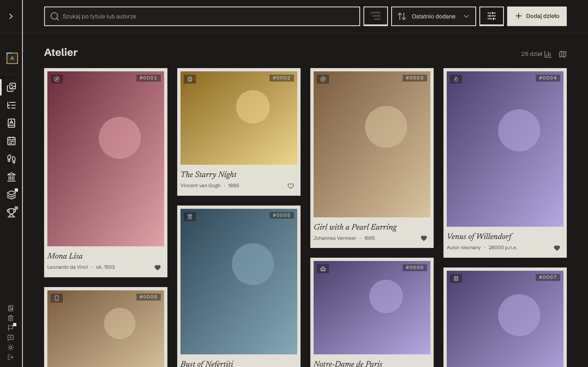
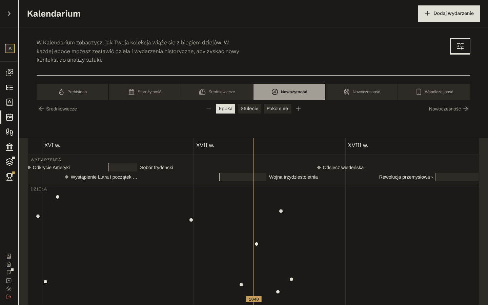

# study-atelier

An app for learning art history, where the learner builds their own atelier: a personal database of artworks assembled as part of studying. The learner writes the data in their own words, adds to an entry as their knowledge grows, and then uses the collection to review and explore. The interface is in Polish. See the [product vision](docs/product/vision.md).



The screenshots show sample data and placeholder images.

## Features

- **Atelier**: the wall of the learner's artworks with search, filters, sorting and grouping; one full form to add and edit an artwork, with images from open sources (Wikimedia Commons) or the learner's own, pins on the image, notes with links between entries and the learner's own fields.
- **Kartoteka**: authors, periods, styles, places and other values, each with its own page and the artworks that use it.
- **Kalendarium, Kronika and Mapa**: the collection placed on a timeline with historical events, in a chronicle of museum visits and on a map.
- **Słowniczek**: a glossary of terms, figures and symbols with definitions from Wikipedia and Wiktionary.
- **Powtórki**: review sessions with spaced repetition, many kinds of questions and a streak.
- **Wystawy, Porównanie and Albumy**: exhibitions the learner arranges, side-by-side comparison of artworks with a loupe, and curated albums.
- **Statistics, Archiwum and Zaplecze**: statistics of the collection, a trash with restore, and a list of missing data to fix.

The full list is in the [requirements](docs/product/requirements.md), and the history in the [changelog](CHANGELOG.md).



## Tech stack

- [SvelteKit](https://svelte.dev) (Svelte 5, TypeScript, Vite) in the browser, deployed to Cloudflare Pages.
- [Supabase](https://supabase.com) for the database, auth, storage and server functions; there is no custom backend ([ADR-0005](docs/decisions/0005-no-custom-backend.md)).
- A component library with design tokens in [`packages/ui`](packages/ui), documented in Storybook.
- [Tiptap](https://tiptap.dev) for notes, [Lucide](https://lucide.dev) icons, Sentry for error reports.
- Vitest and Playwright for tests; Prettier, ESLint, Stylelint and dependency-cruiser for linting.
- GitHub Actions for CI, deployment and database migrations.

The architecture is described in [`docs/architecture`](docs/architecture/).

## Getting started

Requirements: Node.js 22 (see `.nvmrc`) and pnpm 10.

```sh
pnpm install
```

The app needs the Supabase project URL and publishable key. Put `SUPABASE_URL` and `SUPABASE_PUBLISHABLE_KEY` in `apps/web/.env`, then start the dev server:

```sh
pnpm dev
```

To work against a local database instead of a hosted one, run Supabase in Docker (`pnpm db:start`) and sign in with the seeded account; the steps are in the [web app README](apps/web/README.md#local-supabase).

## Scripts

Run from the repository root.

| Command                  | What it does                                               |
| ------------------------ | ---------------------------------------------------------- |
| `pnpm dev`               | Start the web app                                          |
| `pnpm storybook`         | Browse the UI components                                   |
| `pnpm verify`            | Run the checks a change needs before it is pushed          |
| `pnpm lint`              | Prettier, ESLint and Stylelint                             |
| `pnpm check`             | Type check                                                 |
| `pnpm test`              | Unit and component tests                                   |
| `pnpm build`             | Production build                                           |
| `pnpm tokens`            | Generate design tokens from [`design/tokens.json`](design) |
| `pnpm db:start` / `stop` | Start or stop the local Supabase stack                     |
| `pnpm db:reset`          | Replay all migrations and the seed on the local database   |
| `pnpm screenshot <path>` | Capture a route of the app with sample data                |
| `pnpm adr <area>`        | Find the decisions on a topic                              |

The commands of the web app are listed in [`apps/web/README.md`](apps/web/README.md).

## Project structure

```text
apps/web/        SvelteKit app (routes, feature modules in src/lib)
packages/ui/     Component library, design tokens, fonts, Storybook
supabase/        Migrations, seed data, database tests, email templates
design/          Design tokens synced with Figma
docs/            Product, architecture, decisions (ADRs), data model, guidelines
tools/           Scripts behind verify, worktree, adr, db:try and others
.github/         Workflows and the pull request template
```

## Deployment

The app is deployed to Cloudflare Pages from GitHub Actions: `develop` goes to a develop environment and `main` to production. Migrations in [`supabase/migrations`](supabase/migrations) are applied to the matching database by the same pipeline. See [hosted environments](docs/architecture/hosted-environments.md) and the [runbook](docs/architecture/runbook.md).

## Contributing

Work is planned in Linear and decided by the project owner; every decision is recorded as an [ADR](docs/decisions/). Before changing anything, read [`CLAUDE.md`](CLAUDE.md) and the [guidelines](docs/guidelines/): the [working agreement](docs/guidelines/working-agreement.md), [git workflow](docs/guidelines/git-workflow.md) (Gitflow, Conventional Commits, pull requests into `develop`) and [code conventions](docs/guidelines/code-conventions.md). Run `pnpm verify` before pushing.

## License

The repository has no license yet, so all rights are reserved. The code and content may not be reused without the owner's permission.
