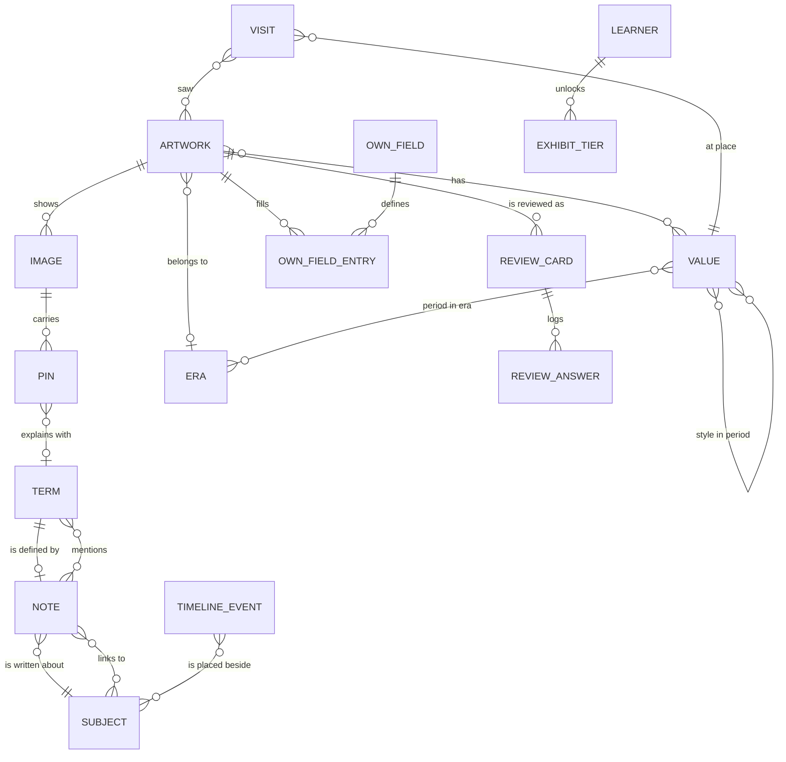

# Conceptual model

Step 2 of the [data model](README.md). The entities and relations the learner works with, taken from the [access patterns](access-patterns.yaml) and drawn without regard to today's tables. Every entity belongs to one learner; the owner is left out of the diagram.

## Entities

| Entity         | What it is                                                                        | Kept today in                                                                           |
| -------------- | --------------------------------------------------------------------------------- | --------------------------------------------------------------------------------------- |
| ARTWORK        | a record with a number, title, year range, type, era, favourite flag, trash state | `artworks`                                                                              |
| IMAGE          | one of up to five images of an artwork, from Commons or uploaded                  | `artwork_images`                                                                        |
| PIN            | a point on an image with a text, optionally explained by a term                   | `artwork_pins`                                                                          |
| VALUE          | an author, period, style, material or place the learner named, with page details  | `category_values` + one `*_details` table per kind                                      |
| ERA            | one of the fixed eras, with the learner's summary and notes                       | `eras` + `era_details`                                                                  |
| OWN_FIELD      | a field the learner added to the artwork card                                     | `artwork_fields`, `categories` (own value lists)                                        |
| VISIT          | a dated visit to a place, with the artworks seen                                  | `visits`, `visit_artworks`                                                              |
| TERM           | a glossary entry with name, synonyms, word forms, category, definition and source | `glossary_entries`                                                                      |
| NOTE           | free text written about one subject; may link to subjects and mentions terms      | a `notes` column in `artworks`, the five `*_details` tables, `era_details` and `visits` |
| SUBJECT        | anything a note can be about or link to: artwork, value, era, visit               | not an entity of its own                                                                |
| TIMELINE_EVENT | a dated event on the timeline                                                     | `timeline_events`                                                                       |
| REVIEW_CARD    | the scheduling state of one artwork facet                                         | `review_cards`                                                                          |
| REVIEW_ANSWER  | one logged answer                                                                 | `review_log`, `free_review_days`                                                        |
| EXHIBIT_TIER   | an unlocked tier of the museum career                                             | `exhibit_tiers`, `point_events`                                                         |

## Relations

Each relation of [access-patterns.yaml](access-patterns.yaml) `relations`, with where it lives today and whether a view needs to read it in the reverse direction.

| Relation                       | Stored today                          | Read in reverse by                        |
| ------------------------------ | ------------------------------------- | ----------------------------------------- |
| artwork has value              | `artwork_values`                      | value page (R07), card index counts (R08) |
| period in era, style in period | `period_eras`, `style_periods`        | card index (R08)                          |
| visit at place, visit saw      | `visits.place_id`, `visit_artworks`   | value page (R07), artwork page (R03)      |
| pin explained by term          | `artwork_pins.glossary_entry_id`      | glossary entry (R10)                      |
| note links to subject          | only as Markdown text `](/atelier/…)` | "Wspomniane w" on R03, R07, R13           |
| note mentions term             | nowhere; matched in the browser       | "Pojawia się w notatkach" on R10          |

The last two rows are the only relations that are not stored. Every view that needs them in reverse has to read the notes of the whole atelier, which is the main finding of [ATL-403](https://linear.app/kamil-nawrot/issue/ATL-403).

## What the model must keep

- A note stays plain Markdown the learner can read in an export.
- A term matches on its name, synonyms and explicit word forms, case-insensitively, between non-letter characters, in notes, in other terms' definitions and on review flashcards.
- A link survives a rename of its target; a merge of two values points it at the value that stays.
- An artwork in the trash keeps its links and mentions and gets them back on restore.
- Every older export imports.
