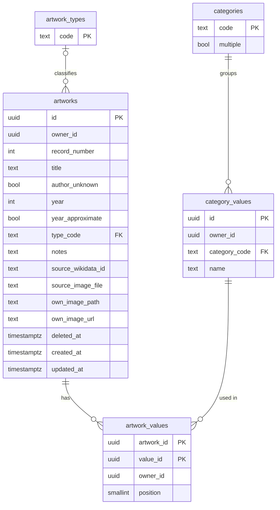

# 0014. Store the atelier in shared category-value tables with per-learner record numbers

- Status: accepted
- Date: 2026-10-10

## Context and problem statement

The MVP needs a database for the [atelier](../product/glossary.md): artworks with a title, authors, a date, a type, periods, styles, materials, a location, notes and one image ([requirements](../product/requirements.md)). Authors, periods, styles, materials and locations are category values that are suggested, shared between artworks and used for filtering (R-7, R-8). Every artwork has a record number `#0001` that is never reused (R-2). Deleted artworks go to a trash first, from which they can be restored with the same number (R-23). The set of fields and categories must be easy to extend in code (R-5). Each learner sees only their own atelier (R-22). The frontend talks to Supabase directly, without a custom backend ([0005](0005-no-custom-backend.md)), so Row Level Security is the only access control.

## Decision drivers

- Correctness enforced in the database, not only in the app: ownership, record numbers, one location per artwork.
- Adding a category or an artwork type is a small migration.
- Simple to query from the Supabase client for the list, search and filters.
- Fits the free plan: no extra services.

## Considered options

Category values:

1. One `category_values` table with a `category_code` column and one `artwork_values` link table
2. A table and a link table per category (`authors` + `artwork_authors`, `styles` + `artwork_styles`, ...)
3. Text arrays on `artworks` (`authors text[]`, `styles text[]`, ...)

Record numbers:

1. A per-learner counter row, incremented by an insert trigger
2. One global Postgres sequence
3. `max(record_number) + 1` at insert time

Artwork type:

1. A lookup table `artwork_types` referenced by a foreign key
2. A Postgres enum
3. A check constraint on a text column

## Decision outcome

Chosen options: category values option 1, record numbers option 1, artwork type option 1.

- Category values: a new category is one row in `categories`, with no new tables or policies, and every category is filtered the same way. Option 2 multiplies tables, policies and queries per category. Option 3 makes "the same value is one value" (R-8) and suggestions depend on exact string matches and cannot be renamed in one place.
- Record numbers: option 2 numbers across all learners, so a second learner would start at a number other than `#0001`. Option 3 reuses the number of a deleted last artwork, which R-2 forbids, and races under concurrent inserts. The counter row is locked by the insert, rolls back with a failed insert, and only ever grows.
- Artwork type: a new type is one inserted row; an enum value cannot be removed later, and a check constraint has to be rewritten to change.

### Schema

- Migration: [`20261010234500_artwork_collection.sql`](../../supabase/migrations/20261010234500_artwork_collection.sql).
- `categories`: `author`, `period`, `style`, `material` (many values per artwork) and `location` (one value per artwork, checked by a trigger).
- `artwork_types`: `architecture`, `painting`, `sculpture`, `drawing`, `printmaking`, `applied_arts`, `photography`, `other`. Codes are stored; the Polish labels live in the app's i18n texts.
- Category value names are unique per learner and category, ignoring letter case, and stored as typed (trimmed). The app creates a value only when the learner explicitly picks the new name (R-9).
- The starting lists of periods, styles and materials (R-24) live in the app, next to the i18n texts, not in the database: they are suggestions in the interface language, and a value is stored only once the learner picks it.
- Near-duplicate hints (R-25) are computed in the app over the learner's own values, which are few. The database only rejects a name that differs from an existing one by letter case.
- `artwork_values.position` keeps the order of authors and other values on an artwork.
- Dates: `year` is a signed integer, negative for years before the common era, with no year 0; `year_approximate` needs a year.
- Images ([0007](0007-images-from-open-sources.md)): the source image is a reference (`source_wikidata_id`, `source_image_file` on Commons, licence, licence URL and attribution). The learner's own image is either a file in the private storage bucket (`own_image_path`) or an `https` URL (`own_image_url`), optionally with `own_image_source_url` pointing to where it was found. The own image overrides the source image. `own_image_source_url` was never used and was dropped by [ADR-0024](0024-save-an-artwork-in-one-database-function.md).
- Trash (R-23): `deleted_at` on `artworks`. Moving to the trash and restoring set and clear it; deleting from the trash removes the row and its links. The app hides trashed artworks from the collection and suggests only values linked to at least one artwork outside the trash.
- Record numbers: `private.record_counters` holds the last number per learner; a `before insert` trigger on `artworks` assigns the next one. The app shows it as `#` plus the number padded to four digits.

### Access control

- Every learner-owned row carries `owner_id`, defaulting to `auth.uid()`. RLS policies allow the `authenticated` role to read and change only rows where `owner_id = auth.uid()`; `anon` gets nothing.
- `artwork_values` references both its artwork and its value together with `owner_id`, so a link between two learners' data cannot exist even if a policy were wrong.
- Grants are explicit, because new Supabase projects give the Data API no default access. Insert and update grants are per column: `owner_id`, `record_number` and timestamps cannot be written by the client.
- The counter table and trigger functions live in a `private` schema that the Data API does not expose.
- Storage bucket `artwork-images` is private, accepts images up to 5 MB, and its policies allow access only to objects under a folder named after the learner's id: `<user id>/<artwork id>/<file name>`. The app shows those images through signed URLs.

### Consequences

- Good: ownership, numbering and one location per artwork hold whatever the client sends.
- Good: adding a category or an artwork type is one inserted row; a new artwork field is one column plus its grants.
- Bad: "author is required unless unknown" (R-4) spans two tables, and the client writes the artwork and its values in separate requests, so the rule is checked in the app, not in the database.
- Bad: saving an artwork with its values takes several requests that are not one transaction; a failure in between leaves an artwork without some values. A database function that saves an artwork in one call can fix both points later.
- Bad: values no longer used by any artwork stay and keep being suggested until removed.
- Bad: deleting an artwork does not delete its uploaded image file; the app has to remove it.

## More information

- Text search (R-18) starts with simple `ilike` filters; a trigram or full-text index can be added when the atelier grows.
- The migration is applied by CI on the next push to `develop` ([0012](0012-database-migrations-from-github-actions.md)); `develop` and `main` share the database, and nothing on `main` uses these tables yet.
